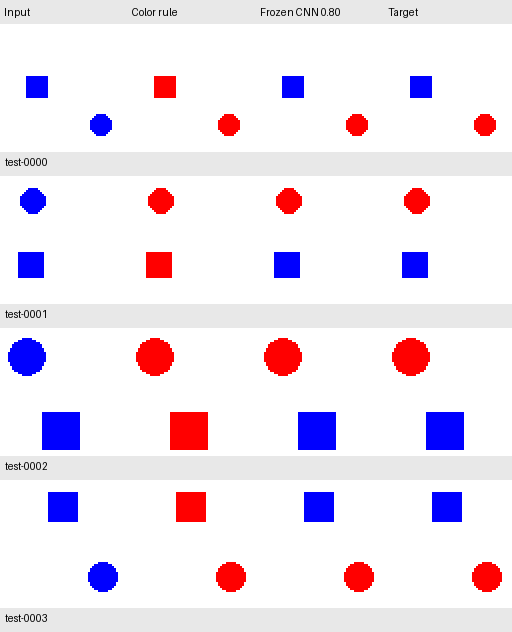

# Visual Learning Lab

[](https://github.com/VishwasSP01/visual-learning-lab/actions/workflows/ci.yml)

**Task:** recolor a blue circle while preserving a blue square and the background.
**Frozen test result:** a 7,425-parameter CNN plus a fixed renderer gets
**711 / 1,000 images completely correct (71.1%)**, versus **0 / 1,000** for the
color-replacement rule. We selected the checkpoint and threshold on validation
data before measuring test performance. This is a controlled synthetic task.



The preview shows the first four test examples, rather than examples selected
for their results. See the [test protocol and limitations](docs/test_evaluation.md)
and [recorded counts](docs/experiments/shape_cnn_v1_test.json).

A laptop-first project exploring neural networks, diffusion models, and reliable
image editing through reproducible experiments.

The goal is to learn how models change a requested part of an image while
preserving everything else. We build this in small steps on an Apple-silicon Mac.

## Try the local demo

With the original spatial dataset and saved checkpoint available locally:

```bash
uv run --locked python scripts/demo.py
```

Open [the local demo](http://127.0.0.1:7860) to browse all 500 validation examples.
It shows the input, CNN edit, and target side by side, with exact-match and
preservation scores for each case. The saved model runs on CPU, using the
validation-selected threshold; the original model's threshold is 0.80.
The demo requires no additional dependencies and performs no training.

Checkpoints and datasets are excluded from Git. See [the demo guide](docs/demo.md)
for prerequisites, a fresh-training route, and how to stop the local server.

## Decisions and lessons

- **Measure whether the edit succeeds.** Returning the unchanged image scores
  94.38% whole-image pixel accuracy on the color-only validation task, but edits
  no circle correctly. We report exact-image success, edit accuracy, and
  preservation separately so the large background cannot hide a failed edit.
- **Make the task require spatial context.** A pixelwise network cannot choose
  between a blue circle and a blue square using color alone. The CNN learns
  where to edit; a fixed renderer applies red. This isolates localization and
  preservation before adding a learned color operation or instructions.
  See the [generalization probes](docs/generalization.md).
- **Choose thresholds against the declared objective.** Among five validation
  candidates, 0.80 gives 338 / 500 exact images; 0.95 gives 252 / 500 because it
  misses more circle pixels. We selected 0.80 by exact-image success before
  evaluating test performance. See the [threshold comparison](docs/confidence_thresholds.md).
- **Freeze decisions before measuring test performance.** The committed
  checkpoint and threshold produced 711 / 1,000 exact test images. That test is
  now observed; instruction conditioning needs a newly reserved holdout.
  This result concerns synthetic shapes, not real-photo editing or language
  understanding. See the [test protocol](docs/test_evaluation.md).
- **Make results traceable.** Versioned configs specify settings and training
  seeds. New reports record the Git revision, dirty status, and config, source,
  and dependency-file hashes. A commit hash alone cannot identify uncommitted
  code. See the [experiment guide](docs/experiment_configs.md).

## Repository layout

```text
src/visual_lab/
  data/          # Synthetic generators and supervised split loaders
  experiments/   # Training, evaluation, and analysis pipelines
  models.py      # PixelMLP and ShapeEditor architectures
  metrics.py     # Exact-image, edit, and preservation measurements
  rendering.py   # Fixed mask renderer and RGB conversion
scripts/         # Thin commands that call the package
tests/           # Fixture-based unit tests
docs/            # Learning notes, recorded reports, and previews
```

`uv sync --locked` installs `visual_lab` in editable mode from `src/`.
Run commands from this repository with `uv run --locked python scripts/<name>.py`.
Datasets and checkpoints remain in the ignored `data/` and `results/` folders.
See [the refactor verification](docs/repository_structure.md) for compatibility
with the recorded experiment and its original source hashes.

## Run an experiment from one config

After generating the spatial dataset described below, train with:

```bash
uv run --locked python scripts/run_experiment.py --config configs/shape_cnn_v1.json
```

The config specifies the data, seed, training settings, device, and output path.
Add `--dry-run` to validate and display those settings without training or writing
files. Ten configs cover the training, baseline, and analysis pipelines.
Their outputs go to `results/reproductions/`; the runner refuses to reuse an
existing output directory. The original commands below remain available.

New reports record the Git revision and dirty status, effective settings, training
seed, config contents and hash, and source/dependency-file hashes. Deterministic
evaluation records `seed: null` with an explanation. Historical benchmark reports
remain unchanged. See [the experiment guide](docs/experiment_configs.md) for
prerequisites, commands, and the distinction between reproduction and new evidence.

## First milestone: build the data

Our first task is deliberately simple:

> Change the blue circle to red. Keep everything else unchanged.

Each 64 x 64 pixel scene contains a blue circle and a separate green square on a
white background. Circle and square sizes and positions vary between examples.

Each example has:

- **Input:** the original scene with a blue circle.
- **Target:** the correct result, with the circle recolored red.
- **Mask:** white pixels identify the intended edit; black pixels must stay unchanged.
- **Instruction:** the text describing the edit.

The target is drawn by ordinary Python code, before training a model.
These masks are ground truth for training and evaluation; a future editor will
receive an image and instruction, not the ground-truth mask by default.

## Run locally

Install [uv](https://docs.astral.sh/uv/getting-started/installation/), then run
these commands from the repository directory:

```bash
uv sync --locked
uv run --locked python scripts/generate_pairs.py
open data/circle_edits_v2/preview.png
```

The script creates **6,500 examples**:

| Split | Examples | Purpose |
| --- | ---: | --- |
| Training | 5,000 | Learn the transformation |
| Validation | 500 | Choose settings and monitor overfitting |
| Test | 1,000 | Evaluate the selected model |

These counts are an initial experiment budget, not a claim that more data is
always better. Learning curves will guide later changes.

The manifest at `data/circle_edits_v2/manifest.jsonl` lists the files, geometry,
and instruction for every example. Paths in the manifest are relative to
`data/circle_edits_v2/`. `metadata.json` records the seed and split protocol.

The base random seed is fixed at 42, with an independent stream for each split.
Input images are deduplicated across all three splits. The script checks the
saved files to confirm that every selected pixel changes from blue to red and
every other pixel stays identical.

### Held-out positions

Circle centers occupy a 4 x 4 grid of spatial tiles. Validation reserves the
top-right and bottom-left tiles; test reserves the top-left and bottom-right
tiles. Training uses the other twelve tiles. Each split therefore has distinct
circle-center positions. Circle sizes and green-square layouts vary as well.

Nearby positions can still be visually similar. This is a modest check of
spatial generalization within one synthetic drawing process, not a claim that
all similar scenes or other forms of leakage have been eliminated. A future
model's data loader must respect these manifest splits rather than reshuffle
the whole dataset.

Regenerating the dataset overwrites its generated files. The generated `data/`
directory and local Python environment are excluded from Git; the code and
dependency lockfile are enough to rebuild this milestone. The earlier 100-pair
debugging dataset remains in `data/circle_edits/`; version 2 is stored separately.

## Automated checks

GitHub Actions installs Python 3.12.16 and the locked dependencies, then runs all
unit tests on every push and pull request. The macOS ARM runner matches the
project's Apple-silicon environment. These fixture-based checks need no generated
dataset, trained checkpoint, or GPU training run.

Run the same checks locally:

```bash
uv sync --locked
uv run --locked python -m unittest discover -s tests -v
```

## How to read the preview

Each row shows one example. There are two rows per split, labeled underneath.
The columns are the input image, target image, and edit mask. The green square
must be identical before and after the edit.

## Baseline: check the evaluation before learning

A baseline is a simple reference solution. We evaluate two methods:

- **Unchanged:** return the input image without editing anything.
- **Color rule:** replace every exact blue RGB pixel `(0, 0, 255)` with red
  `(255, 0, 0)`. This method receives only the input image.

Neither method uses the target image, ground-truth mask, geometry, or instruction
to produce its output. The evaluator reads targets and masks to score results.

Run the baseline and its hand-calculated metric checks:

```bash
uv run --locked python -m unittest -v tests.test_evaluate_baseline
uv run --locked python scripts/evaluate_baseline.py
open results/baselines/validation_preview.png
```

The default evaluation uses the **500 validation examples**. The test set is
reserved for later. The report at `results/baselines/validation.json` contains
raw counts, scores, and hashes identifying the evaluated data. Generated results
are excluded from Git and can be reproduced with the command above.

We measure:

- **Exact image success:** fraction of images where every pixel matches the target.
- **Edit pixel accuracy:** fraction of pixels inside the mask matching the target.
- **Background preservation:** fraction of pixels outside the mask left unchanged.
- **Whole-image pixel accuracy:** fraction of all pixels matching the target.

Pixel rates pool counts across images. This matters because most pixels are
background: an unchanged image can score highly on whole-image accuracy while
completely failing the requested edit. The checks use three-pixel examples with
hand-calculated answers, including a deliberately broken all-red output.

Measured on the current 500-example validation split:

| Method | Exact image success | Edit pixel accuracy | Background preservation | Whole-image pixel accuracy |
| --- | ---: | ---: | ---: | ---: |
| Unchanged | 0% | 0% | 100% | 94.38% |
| Color rule | 100% | 100% | 100% | 100% |

The rule solves this controlled task perfectly. A neural network will be a
learning exercise, not an improvement over this rule. Later tasks will need
additional ambiguity and variation before model complexity can be justified.

## First neural network: learn a pixel-color mapping

We now have a tiny PyTorch network: **3 RGB inputs -> 16 hidden units -> 3 RGB
outputs**, with ReLU between the layers and **115 learned parameters**.
It applies the same learned transformation independently to each pixel.

```bash
uv sync --locked
uv run --locked python scripts/train_pixel_model.py
open results/pixel_mlp/preview.png
```

The default run trains on 5,000 images for ten epochs with Adam, batch size 64,
and learning rate 0.01. It uses the Mac GPU through MPS when available, otherwise
CPU. `--device cpu` explicitly selects CPU. No external service is required.

Inputs and targets are normalized from `[0, 255]` to `[0, 1]` in each batch.
Only input pixels enter the network. Targets supply the training loss; masks
are used only for scoring the selected model. No test images are loaded.

The first local run selected epoch 6 using the lowest validation MSE:

| Measurement | Observed result |
| --- | ---: |
| Initial validation MSE | 1.5150364 |
| Selected validation MSE | approximately 1.4e-17 |
| Exact validation images after 8-bit conversion | 500 / 500 |
| Edit pixel accuracy | 100% |
| Background preservation | 100% |

The experiment writes the selected weights to `results/pixel_mlp/model.pt` and
the configuration, dataset hashes, epoch losses, and scores to
`results/pixel_mlp/validation.json`. Rerunning overwrites these generated files.
Seeds and dependencies are fixed; exact GPU numerics can vary between runs.

The very small loss reflects the task's limited palette: only three distinct
input colors. Position holdouts do not challenge this pixelwise architecture,
which never sees coordinates. Neither object recognition nor instruction
understanding is demonstrated. This exercise teaches learning and optimization;
it does not outperform the perfect fixed rule on this controlled task.

Read [the short learning notes](docs/first_neural_network.md) for an explanation
of pixels, parameters, loss, backpropagation, and epochs.

## Inspecting generalization

```bash
uv run --locked python scripts/inspect_pixel_model.py
open results/pixel_mlp/diagnostics/colors.png
open results/pixel_mlp/diagnostics/shapes.png
```

These exploratory diagnostics use the saved weights without retraining or
accessing the held-out test dataset:

- All three familiar input colors are handled correctly.
- All five unfamiliar colors tried are incorrectly changed under the declared
  diagnostic contract (exact blue becomes red; all other colors stay unchanged).
- In one new scene containing a blue circle and a blue square, both the learned
  model and the color rule recolor the square incorrectly. Each changes 225
  pixels that should be preserved, while correctly editing the circle.

These are constructed probes, not population-level benchmark scores. They
show why the original perfect validation score should not be interpreted as
general editing ability. See [the explanation](docs/generalization.md) and
`results/pixel_mlp/diagnostics/report.json` for the inputs, outputs, and scope.

## Next dataset: edit by shape rather than color

```bash
uv run --locked python scripts/generate_spatial_pairs.py
open data/shape_edits_v1/preview.png
```

This separate dataset has 5,000 training, 500 validation, and 1,000 test examples.
Both shapes are now blue, and their bounding-box widths and heights match.
The target recolors only the circle, preserving the blue square and white
background. Sizes and positions vary, with the same held-out circle-position
tile protocol used above.

The manifest adds a `square_mask` so the next experiment can measure preservation
of the distractor separately from the large white background. Masks and geometry
are ground-truth labels; they must not be provided as model inputs.
The generator checks the actual saved files for correct edits, preservation,
and non-overlapping masks. The CNN experiment below learns from this dataset.

See [the spatial dataset explanation](docs/spatial_dataset.md) for the task,
checks, split protocol, and limitations. The preview shows one example per split:
input, target, circle edit mask, and square preservation mask.

## First spatial model: learn where to edit

```bash
uv run --locked python -m unittest discover -s tests -v
uv run --locked python scripts/train_spatial_model.py
open results/spatial_cnn/preview.png
```

A small **7,425-parameter CNN** receives only the RGB image and predicts an
edit-region mask. Its convolutional layers have a theoretical 31 x 31 receptive
field. Ground-truth masks are supervision labels, not input channels. A separate
fixed renderer paints the predicted region red; the color operation is not learned.

The first run trained for twelve epochs on 5,000 examples and selected epoch 12
by lowest weighted validation loss. The 1,000 test examples were not loaded.

| Validation measurement | Color rule | CNN plus renderer |
| --- | ---: | ---: |
| Circle pixels edited correctly | 100% | 99.86% |
| Square pixels preserved | 0% | 99.10% |
| Entire images correct | 0 / 500 | 210 / 500 (42%) |
| Edit-mask IoU | 43.61% | 98.27% |

The distinction between per-pixel accuracy and exact images matters: a few
incorrect pixels still make the whole image incorrect. The first four validation
examples below include visible boundary errors; they were not cherry-picked.


See [the CNN explanation](docs/spatial_model.md) and
[recorded experiment](docs/experiments/shape_cnn_v1.json) for training settings,
raw counts, checkpoint verification, and limitations. The recorded preview and
small JSON report are versioned; generated datasets and model weights remain
excluded from Git.

## Diagnose the remaining errors

```bash
uv run --locked python scripts/analyze_spatial_errors.py
open results/spatial_cnn/error_analysis/worst_cases.png
```

The frozen checkpoint reproduces the original validation counts on CPU.
Its 1,639 wrong pixels consist of 1,091 unwanted square edits, 421 unwanted
background edits, and 127 missed circle pixels. The closest 35 images contain
823 of those errors: 7% of the images account for about half the wrong pixels.

These are exploratory validation associations, not causal claims or test
results. The script groups errors by foreground separation, circle radius,
and distance to the image edge, and saves a record for every validation image.
The displayed examples are explicitly the four worst by wrong-pixel count.

See [the error analysis](docs/spatial_error_analysis.md) and
[recorded report](docs/experiments/shape_cnn_v1_errors.json). No model weights or
thresholds were changed during this analysis.

## Compare confidence thresholds

```bash
uv run --locked python scripts/compare_thresholds.py
open results/spatial_cnn/threshold_sweep/preview.png
```

With weights held fixed, we compared the predeclared thresholds 0.50, 0.70,
0.80, 0.90, and 0.95 on the same 500 validation images. Selection prioritizes
exact images, then fewer wrong pixels, then the lower threshold.

The selected **0.80** threshold increases exact validation images from
**210 / 500 (42%) to 338 / 500 (67.6%)**. Wrong pixels decrease from 1,639 to
1,101. Square preservation improves from 99.095% to 99.585%, while circle-edit
accuracy decreases from 99.864% to 99.540%. A higher threshold is not always
better: 0.95 misses substantially more circle pixels.

The comparison records unchanged checkpoint hashes, reproduces the original
0.50 counts, and saves a selected configuration for later test evaluation.
These are validation-selection results, not final test scores. The sigmoid
scores have not been established as calibrated correctness probabilities.

See [the threshold experiment](docs/confidence_thresholds.md),
[recorded report](docs/experiments/shape_cnn_v1_thresholds.json), and
[selected configuration](docs/experiments/shape_cnn_v1_selected_config.json).

## Evaluate the frozen model on test data

```bash
uv run --locked python scripts/evaluate_frozen_model.py
open results/spatial_cnn/frozen_test/preview.png
```

The selected checkpoint and threshold 0.80 were committed before this evaluation.
The evaluator verifies their hashes against the recorded configuration before
loading the 1,000 test examples. It performs no training or threshold selection.

| Frozen CNN measurement | Validation (500 images) | Test (1,000 images) |
| --- | ---: | ---: |
| Exact images | 67.6% | **71.1%** |
| Circle pixels edited correctly | 99.540% | 99.685% |
| Square pixels preserved | 99.585% | 99.691% |

The frozen CNN produces 711 completely correct test images; 289 contain at least
one error. The fixed color rule produces zero completely correct test images
because it also recolors every blue square. Dataset-integrity checks and previews
had inspected test files earlier, but model/threshold selection did not use test
performance. These scores describe this synthetic task, not real photographs.

See [the frozen test evaluation](docs/test_evaluation.md) and
[recorded report](docs/experiments/shape_cnn_v1_test.json) for the protocol,
counts, example outputs, and limitations.

## Scope and next step

This is synthetic learning data, not evidence of real-photo editing capability.
The first experiment's splits share the same drawing process and instruction;
they do not establish generalization to new object types, instructions, or real
images. In particular,
the original color-only task can be solved by a simple color-replacement rule,
which remains a baseline when interpreting neural-network results. Learning a
single fixed transformation does not demonstrate language understanding.

The first experiment is now recorded through frozen test evaluation. The next
data milestone introduces **instruction conditioning**: each scene has both an
“edit circle” and an “edit square” request, kept together in one split. The
generator creates 3,250 unique scenes and 6,500 requests, with fresh validation
and test examples. The new model receives RGB plus a learned instruction embedding.

```bash
uv run --locked python scripts/generate_instruction_pairs.py
```

See [the instruction data contract](docs/instruction_conditioning.md) for scene
grouping, categorical instruction IDs, label rules, and the paired-scene metric.
The [recorded construction audit](docs/experiments/instruction_edits_v1_data.json)
verifies all 6,500 requests and zero input overlap with the previous spatial dataset.
The [first conditioning comparison](docs/instruction_model.md) records both
12- and 24-epoch runs with a matched instruction-blind control. At the fixed 0.50
threshold, the longer run gets **174 / 500 validation requests exact**, but only
**9 / 250 scenes** have both requests exact; the control completes zero scenes.
Square requests still damage circle pixels, so preservation needs improvement.
These are validation results; the new test set remains reserved. Larger
generative models are later experiments.

The original `scripts/draw_circle.py`, `blue_circle.png`, and `red_circle.png` are kept
as the first hand-created examples.

## License

This project is licensed under the [MIT License](LICENSE).
