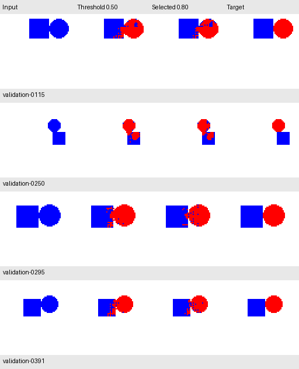

# Choosing when the CNN should edit

The first CNN edited a pixel whenever its sigmoid score was at least 0.50.
Here we keep its saved weights fixed and change only that decision threshold.
The network produces the same logits for every candidate, computed once on CPU.

A higher threshold requires a larger score before editing. These scores have
not been shown to be calibrated probabilities of correctness: 0.90 does not
establish that an edit has a 90% chance of being right.

## Experiment fixed before measuring

We declared five candidates: **0.50, 0.70, 0.80, 0.90, and 0.95**.
Selection prioritizes the most completely correct validation images, then the
fewest wrong pixels, then the lower threshold. We did not expand the grid after
seeing the scores. The same 500 validation images were used throughout.

The comparison verifies that threshold 0.50 reproduces all raw counts from the
original run. It also checks that higher thresholds never introduce new edit
pixels and that the checkpoint file remains unchanged.

## Results

| Threshold | Exact images | Circle pixels edited correctly | Square pixels preserved | Wrong pixels |
| --- | ---: | ---: | ---: | ---: |
| 0.50 | 210 / 500 (42.0%) | 99.864% | 99.095% | 1,639 |
| 0.70 | 303 / 500 (60.6%) | 99.715% | 99.441% | 1,191 |
| **0.80** | **338 / 500 (67.6%)** | **99.540%** | **99.585%** | **1,101** |
| 0.90 | 315 / 500 (63.0%) | 98.981% | 99.729% | 1,370 |
| 0.95 | 252 / 500 (50.4%) | 98.092% | 99.823% | 2,037 |

**0.80 is selected among these five candidates.** This improves a validation
operating point; the model has not learned new weights during this experiment.

The tradeoff is visible in the underlying error counts:

| Error type | Threshold 0.50 | Selected 0.80 |
| --- | ---: | ---: |
| Unwanted square edits | 1,091 | 500 |
| Unwanted white-background edits | 421 | 172 |
| Missed circle pixels | 127 | 429 |

Increasing the threshold reduces unwanted edits but misses more of the circle.
The highest tested threshold is not the best under the predeclared objective.

This is not an improvement on every image: at 0.80, 212 images have fewer wrong
pixels, 37 have more, and 251 have the same error count. There are 135 newly
exact images and seven formerly exact images that become incorrect.

## Visual comparison

These are the four worst cases at the original 0.50 threshold, selected by error
count with example ID as a tiebreaker. They are not chosen to favor the selected
threshold. Remaining square damage and missed circle pixels are visible.



## Reproduce and freeze the candidate

After generating the spatial dataset and training the first CNN:

```bash
uv run --locked python -m unittest discover -v
uv run --locked python compare_thresholds.py
open results/spatial_cnn/threshold_sweep/preview.png
```

The script saves the report, all 2,500 per-image/candidate records, a preview,
and `selected_config.json` under `results/spatial_cnn/threshold_sweep/`.
The chosen configuration includes the checkpoint and manifest hashes, making
the selected operating point explicit for later evaluation.

The original training script and its 0.50 results are retained. Its default
inference helper is not silently changed; the selected threshold is applied by
the comparison script and recorded in the configuration.

The [recorded report](experiments/shape_cnn_v1_thresholds.json) contains all raw
counts and provenance. The [recorded selected configuration](experiments/shape_cnn_v1_selected_config.json)
identifies the exact checkpoint used in this experiment.

## Limits and next step

These are selection results on validation data already used for checkpoint
selection. They do not establish unbiased final performance, universal score
calibration, or optimality over every possible threshold.

No test images have been opened. The next step is to evaluate this frozen
checkpoint and threshold once on the reserved 1,000-image test split, without
choosing a different threshold from test results.
