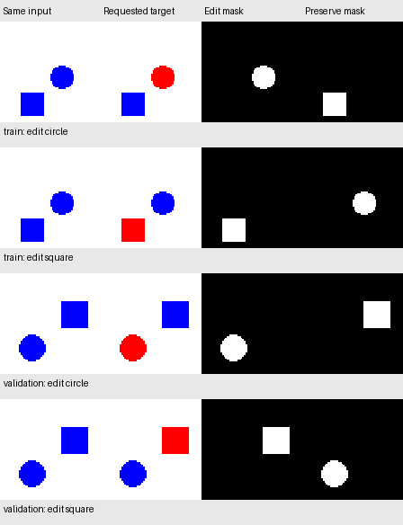

# Instruction conditioning: data contract

The next task adds a choice to the existing synthetic editor. For every scene,
the **exact same input image** appears with two different requests:

| Instruction ID | Requested edit | Preserve |
| --- | --- | --- |
| 0 | Recolor the blue circle red | Blue square and white background |
| 1 | Recolor the blue square red | Blue circle and white background |

The model inputs are RGB pixels and this two-value categorical ID.
The text strings make the task readable; choosing between two predefined IDs
does not establish free-form language understanding. Learned text conditioning
can be a separate later experiment.

## Why this requires conditioning

An image-only model returns the same prediction for the same image. Because the
two targets differ, that model cannot get both requests exactly correct. On
these balanced pairs it can achieve at most 50% exact-request success and 0%
success at getting both requests right for a scene. This is a ceiling, not a
measured model result.

Evaluation reports both exact-request success and **paired-scene
success**: both instructions must produce their complete correct targets.
Requested-object accuracy and opposite-object/background preservation remain
separate measurements. A large white background must not hide unwanted edits.

## Data and splits

The generator reuses the established 64 × 64 renderer: a blue circle and blue
square, non-overlapping and with matching bounding-box sizes. The scene is
assigned to a split before its two requests are created.

| Split | Unique scenes | Requests |
| --- | ---: | ---: |
| Training | 2,500 | 5,000 |
| Validation | 250 | 500 |
| Newly reserved test | 500 | 1,000 |
| Total | 3,250 | 6,500 |

Two requests for a scene share one input file. They always stay in the same
split. Input pixel hashes must be unique between scenes, so neither another
instruction nor a renamed scene can leak the same image into a different split.
The 6,500 requests are not 6,500 independent input scenes.

The fixed dataset seed is **20261029**, with independent streams `seed + 0`,
`seed + 1`, and `seed + 2` for training, validation, and test. The spatial tile
protocol is reused from the first experiment. This reserves new examples within
the same synthetic drawing process; it is not a new rendering distribution or
a new collection of object types. Model quality has not been measured on this
new test set.

## Generate and inspect

```bash
uv run --locked python scripts/generate_instruction_pairs.py
open data/instruction_edits_v1/preview.png
```

The output directory must be new. Use `--output` to choose a separate directory
for a repeat run. Inputs, targets, masks, and manifests remain excluded from Git.

`manifest.jsonl` contains one record per request: request ID, scene ID, split,
instruction ID and text, input pixel hash, file paths, and construction geometry.
Each request points to its requested edit mask and opposite-shape preservation
mask. Targets, both masks, and geometry are labels for supervision or audits;
they must never enter the model as input features.

The generator checks the serialized files: selected pixels turn from blue to
red, every unselected pixel remains identical, the masks do not overlap, and
the input hash matches the saved pixels. It also checks request pairs, scene
isolation, instruction assignments, and counts before completing the manifest.

`metadata.json` records the seed, split rules, scene/request counts, manifest
hash, source/dependency hashes, and Git revision/dirty status. The preview
contains only the first training and validation scene, each shown under both
instructions. Test files receive construction-integrity checks but no preview
or model-performance evaluation.

## Recorded construction audit

The full dataset was generated from clean revision
[`8c59a89`](https://github.com/VishwasSP01/visual-learning-lab/commit/8c59a8923c606b1733f02cadb60f4159703189f9).
An independent NumPy audit of all 6,500 saved requests confirmed the requested
recoloring, preservation, mask separation, geometry, input hashes, and pairing.
There are 3,250 distinct input pixel hashes, with zero reuse between splits and
zero overlap with the previous `shape_edits_v1` dataset's 6,500 scenes.

See the [construction metadata and audit counts](experiments/instruction_edits_v1_data.json).
The report fingerprints the new manifest, all PNG paths/bytes, and the previous
manifest used for the overlap comparison. At construction time no model had
been trained on this dataset. Subsequent validation-only training is documented
in [the conditioning experiment](instruction_model.md); new-test performance
has not been measured.

The rows below show renderer-produced targets and supervision masks before
training. Each scene appears under both requests; test scenes are omitted.



## Learning progress

The [first conditioned CNN comparison](instruction_model.md) now records 12- and
24-epoch runs against a matched instruction-blind control on validation data.
Its remaining preservation errors need validation analysis before freezing a
configuration and evaluating the newly reserved test set. The original
711 / 1,000 frozen benchmark remains a separate historical experiment.
