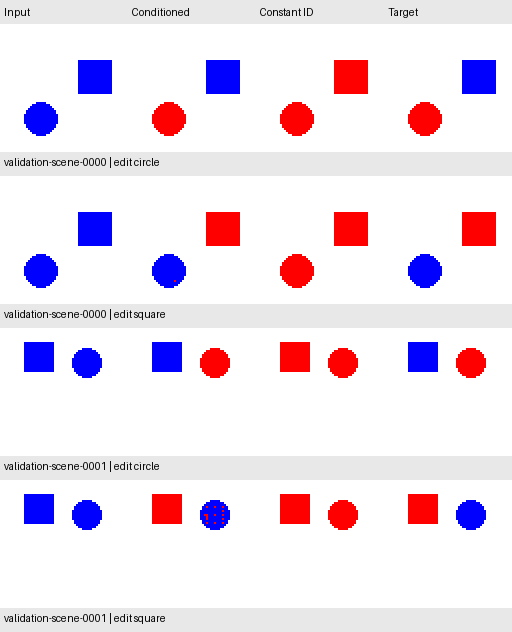

# First instruction-conditioned CNN

The model receives an RGB image and one categorical request: ID 0 edits the
circle; ID 1 edits the square. A learned `Embedding(2, 4)` maps each ID to four
numbers. Those numbers become constant spatial channels beside RGB, giving the
CNN seven input channels. Backpropagation updates the embedding and convolutions
together. This is categorical conditioning, not free-form language understanding.

The CNN retains four 16-channel 3 × 3 convolutional layers with dilations 1, 2,
4, and 8, ReLU activations, and a 1 × 1 mask-logit head. Its receptive field is
31 × 31; the architecture has **8,009 parameters**, including eight embedding
values. A fixed renderer paints the predicted region red.

Targets, geometry, edit masks, and preservation masks are labels. They are never
concatenated with the image or supplied to the forward method. Label masks
supply the loss; targets and preservation masks supply evaluation only.

## Protocol declared before the full run

| Setting | Value |
| --- | --- |
| Dataset | `instruction_edits_v1`, bound by manifest SHA-256 in the config |
| Training | 2,500 scenes / 5,000 requests |
| Validation | 250 scenes / 500 requests |
| Seed | 42 |
| Epochs | 12 for each of two models |
| Batch size | 64 |
| Optimizer | Adam, learning rate 0.001 |
| Loss | Weighted BCE with positive weight from training masks only |
| Checkpoint selection | Each model's lowest weighted validation BCE |
| Mask threshold | 0.50, fixed before evaluation; no sweep in this experiment |
| Evaluation device | CPU after training, using the selected weights |

The model with instructions and its control use the same architecture, seed,
starting weights, training examples, batch order, optimization, and epoch budget.
The control replaces every instruction with ID 0 during both training and
inference. It therefore learns from the same conflicting paired labels without
receiving the information needed to distinguish them. Starting state hashes are
required to match; the selected states and embedding changes are also recorded.

The differentiable mask loss selects the checkpoint. The primary reported
behavior is **paired-scene success**: both instructions must match their complete
targets exactly. Exact-request success, requested-region accuracy, and
opposite-object/background preservation are reported separately, with counts for
circle and square requests. A high pixel rate cannot establish a successful edit.

## Comparisons

Four methods are evaluated on the same validation requests:

- **Conditioned:** the trained model receives the actual requested IDs.
- **Instruction-blind:** the separately trained, matched model always receives
  ID 0. Any fixed output for one image can satisfy at most one of its two targets.
- **Conditioned, clamped to circle:** the trained conditioned model receives ID 0
  for both requests. This checks whether removing the choice changes behavior.
- **Conditioned, swapped IDs:** the trained conditioned model receives the other
  request's ID while scoring still uses the originally requested target.

Each scene has byte-identical inputs under both requests. The two counterfactual
checks reuse that scene's already computed output for the selected ID; no target
or mask is used to choose the output. A test verifies equivalence with direct
forward passes under changed IDs. The report also counts scenes where changing
the ID changes the rendered output. Changed outputs alone do not prove correct
edits, so paired-scene success remains the primary behavioral check.

## Run and inspect

The dataset must already exist. Generate it once with
`uv run --locked python scripts/generate_instruction_pairs.py` if needed. Then:

```bash
uv run --locked python scripts/run_experiment.py --config configs/instruction_cnn_v1.json
open results/reproductions/instruction_cnn_v1/preview.png
```

The output directory must be new. The run writes `conditioned.pt`,
`instruction_blind.pt`, `validation.json`, `validation_cases.jsonl`, and a preview
of the first two validation scenes under both requests. Checkpoints contain CPU
weights; the report includes config, revision, data/source hashes, training
history, selected epochs, embedding changes, and all four comparisons.

The training loader permits only training and validation image access. Tests
delete every test image before an end-to-end fixture run, demonstrating that
the pipeline does not depend on those files. The new 500-scene test set stays
reserved. This experiment does not replace the original fixed-circle benchmark.

## First 12-epoch result and next declared run

The first run used clean revision
[`eaf3573`](https://github.com/VishwasSP01/visual-learning-lab/commit/eaf3573a0bc95c07f9206fc40cdadb3222bd8a1d).
The conditioned model gets **12 / 500 requests exact (2.4%)**, and **0 / 250
scenes** have both requests exact. The constant-ID control gets zero exact
requests and zero exact scene pairs. These results are retained in the
[original validation report](experiments/instruction_cnn_v1_validation.json).

Changing the instruction changes the conditioned output on all 250 validation
scenes, and swapping the IDs reduces exact requests to zero. This confirms an
effect of the ID, but does not establish reliable editing. Opposite-object
preservation is only 81.41% overall, with 63.92% for square-edit requests.

Validation loss is still improving: 0.12467 at epoch 8 and 0.04830 at epoch 12.
Before measuring any test performance, a separate `instruction_cnn_v2` config
extends **both models to 24 epochs**. It keeps the architecture, seed, optimizer,
batch size, loss, manifest, and 0.50 threshold unchanged. This is a validation-led
training-budget change; the first result is not overwritten or presented as a
successful editor. The config and this rationale are committed before that run.

```bash
uv run --locked python scripts/run_experiment.py --config configs/instruction_cnn_v2.json
```

The first two validation scenes under the original 12-epoch model:


## Recorded 24-epoch validation result

The longer comparison ran from clean revision
[`6c7d368`](https://github.com/VishwasSP01/visual-learning-lab/commit/6c7d368bbdcd9d133e59031644d4623ca24ae1e0).
Both models selected epoch 24 by their own validation loss. The conditioned loss
reached 0.00810, versus 0.18956 for the constant-ID control. The threshold remained
0.50; no threshold search or test-image access occurred.

| Validation method | Exact requests / 500 | Both edits exact / 250 scenes |
| --- | ---: | ---: |
| Matched instruction-blind model | 0 (0%) | 0 (0%) |
| **Conditioned model** | **174 (34.8%)** | **9 (3.6%)** |
| Conditioned model, both IDs clamped to circle | 164 (32.8%) | 0 (0%) |
| Conditioned model, swapped IDs | 0 (0%) | 0 (0%) |

The effect of conditioning is observable, but reliability remains low. Circle
requests account for 164 / 250 exact edits; square requests only 10 / 250.
When editing a square, the model preserves only 90.12% of the circle's pixels.
The preview shows unwanted red pixels on circles that should stay blue.

Whole-image pixel accuracy is 99.77%, yet only 3.6% of scenes satisfy both edits
completely. Paired-scene success requires all 8,192 target pixels across both
requests to match. The reported 99.97% requested-region accuracy therefore does
not make this a reliable editor. Opposite-object preservation is 95.32% overall.

Both learned embedding rows moved during optimization, and changing IDs changes
the output on all 250 validation scenes. Swapping the IDs destroys exact-request
success. The comparison supports a learned dependence on the two task IDs;
it does not establish general language understanding or robust visual editing.

See the [full 24-epoch report](experiments/instruction_cnn_v2_validation.json),
including checkpoint hashes, both learning histories, per-task raw counts,
embedding changes, and config/source provenance. An independent NumPy pixel
audit after reloading the saved CPU checkpoints reproduced all four methods'
aggregate, per-instruction, and paired-scene counts for both recorded runs.
MPS numerics can vary between runs; these are recorded single-seed validation
comparisons, not evidence of statistical robustness.

The first two validation scenes, retained in manifest order:



The next step is to diagnose the unwanted circle edits during square requests
and compare validation operating thresholds against paired-scene success.
The new test set remains reserved until the model and settings are frozen.
