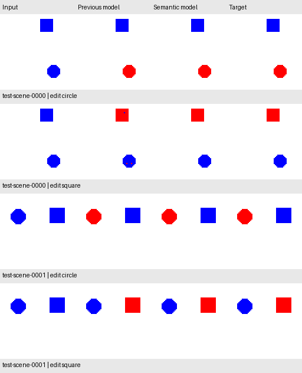

# Frozen instruction-editor test evaluation

## Protocol committed before the first model-performance test

The [frozen plan](experiments/semantic_dilated_v2_frozen_plan.json) binds the
existing seed-42 **SemanticDilatedEditor** checkpoint to the instruction manifest
and the previous **InstructionEditor** checkpoint. The semantic model uses
three-class argmax with lowest-index tie breaking and fixed categorical class
selection. The reference keeps its validation-selected **0.95 cutoff**.

Only these two existing models are evaluated. There is no training, alternate
seed comparison, threshold search, decoder selection, or other setting change.
The primary metric is exact scene pairs: both full targets must match. Report
exact requests, each instruction separately, requested-pixel accuracy,
opposite-object/background preservation, error counts, and paired changes.

The dataset reserves **500 test scenes / 1,000 requests**, with the same two
requests grouped by scene. Manifest-only checks precede image loading. Both
checkpoint hashes and the manifest hash must match before any test image is
opened. A dedicated frozen evaluator loads test images; the training loader's
test prohibition stays in place. Final inference and scoring use CPU.

```bash
uv run --locked python scripts/run_experiment.py --config configs/semantic_dilated_v2_frozen_test.json
```

The output directory must be new. An evaluation-start marker prevents silent
reuse after an interrupted run. The command saves reports, per-request cases,
binary predicted masks, and the first four test requests in manifest order.
Saved masks allow an independent pixel-count audit without another model pass.
The report fingerprints models, plan, manifest, evaluated files, saved masks,
code, dependencies, and Git revision. Model/plan bytes are checked again at end.

Construction integrity checks had already read test files. The relevant claim
is that **test model performance did not guide development or selection**.
After this run the test is observed; repeated evaluations of the same test
are reproduction checks rather than fresh evidence. Future tuning must not be
presented as retaining an unseen test on these same examples.

These are synthetic shapes from one rendering process with held-out circle
positions. They do not establish real-photo editing or language understanding.

## Recorded frozen result

The evaluator ran from clean revision
[`fc7640d`](https://github.com/VishwasSP01/visual-learning-lab/commit/fc7640de037628a8c1fb59f05413a4c1fb166808),
after the plan and evaluator were committed and pushed. Neither checkpoint,
the plan, nor the manifest changed during the run.

| Frozen test measurement | Previous binary editor, cutoff 0.95 | Joint semantic editor |
| --- | ---: | ---: |
| Exact requests / 1,000 | 542 (54.2%) | **972 (97.2%)** |
| Exact scene pairs / 500 | 178 (35.6%) | **482 (96.4%)** |
| Exact circle requests / 500 | 360 | **483** |
| Exact square requests / 500 | 182 | **489** |
| Requested pixels correct | 99.5941% | **99.9820%** |
| Opposite-object pixels preserved | 98.8824% | **99.9820%** |
| White-background pixels preserved | 99.9969% | **99.9993%** |
| Total wrong pixels | 3,237 | **100** |

Relative to the reference, 430 requests and 304 scene pairs become exact, with
no lost exact requests or pairs. The semantic model's remaining 100 wrong pixels
comprise 37 missed intended edits, 37 unwanted edits to the opposite object,
and 26 unwanted white-background edits. Twenty-eight requests and eighteen
scene pairs are still imperfect; high pixel rates do not erase those failures.

The selected model's validation result was 491/500 exact requests (98.2%) and
244/250 exact pairs (97.6%). Frozen test results are 97.2% and 96.4%, respectively.
This supports generalization to reserved scenes within this synthetic process,
with the limitations above. No other seed or operating point was tried on test.

An independent NumPy audit read the saved binary prediction masks and test image
files without invoking a model again. It reproduced every aggregate and
per-instruction raw count and the exact scene-pair counts for both methods.
Saved-mask and checkpoint SHA-256 hashes also match the report and frozen plan.

The [full report](experiments/semantic_dilated_v2_test.json) includes provenance,
counts, evaluated-file hashes, and the embedded pre-test plan. The preview shows
the first two test scenes under both requests, in manifest order:



The instruction test set is now **observed**. Future changes need a new held-out
evaluation protocol before another claim of unseen performance. The selected
configuration's historical `test_model_performance_measured: false` records its
selection state before test; it does not mean this evaluation has not happened.
