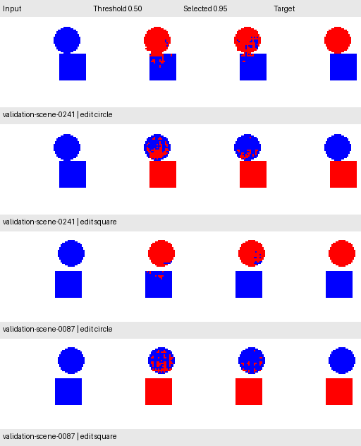

# Instruction-model validation thresholds

**Current status:** this validation-selected reference was subsequently compared
with the semantic editor in the [frozen test](instruction_test_evaluation.md).
The test is now observed; the pre-test protocol and results below are retained.

## Protocol declared before the full sweep

Keep the 24-epoch conditioned checkpoint fixed. Verify its SHA-256 and the
manifest against the original validation report, then reproduce all original
0.50 validation scores before accepting a comparison. Infer once on CPU using
RGB and the requested categorical ID; reuse those logits for every candidate.

Compare the fixed shared grid **0.50, 0.70, 0.80, 0.90, 0.95**. Use one cutoff
for both instructions. Select the most exact **scene pairs** (both requests
completely correct), then most exact requests, then fewest wrong pixels, then
lowest threshold. No per-instruction cutoff search or retraining is part of
this experiment. The new test images remain reserved.

Report per-instruction missed requested pixels, unwanted opposite-object edits,
and unwanted background edits. Compare improvements and regressions on each
request and scene against 0.50. Preview both requests for the two worst scenes
at 0.50, breaking ties by scene ID; this is an explicitly selected failure
preview, not a representative sample.

```bash
uv run --locked python scripts/run_experiment.py --config configs/instruction_cnn_v2_thresholds.json
```

The output directory must be new. The command saves the report, all candidate
case records, a selected configuration, and a before/after preview. It refuses
changed reference files and preserves existing output. This is validation-based
operating-point selection; sigmoid scores are not proven correctness
probabilities. Improvements here will require a later frozen test evaluation.

## Recorded validation result

The sweep ran from clean revision
[`f8236ef`](https://github.com/VishwasSP01/visual-learning-lab/commit/f8236ef7145af0bb216502a9b258767b2c075eec).
The conditioned checkpoint SHA-256 remains
`a828fe69b4728e2769304bb6e98ea4c22ed045437c83e4884dab5bfbb11f4d69`.
Every score at 0.50 reproduces the original report. No training was performed.

| Shared cutoff | Exact requests / 500 | Both edits exact / 250 scenes | Missed requested pixels | Unwanted opposite-object edits | Unwanted background edits |
| --- | ---: | ---: | ---: | ---: | ---: |
| 0.50 | 174 (34.8%) | 9 (3.6%) | 33 | 4,565 | 79 |
| 0.70 | 241 (48.2%) | 40 (16.0%) | 51 | 3,073 | 60 |
| 0.80 | 272 (54.4%) | 58 (23.2%) | 69 | 2,244 | 47 |
| 0.90 | 294 (58.8%) | 75 (30.0%) | 131 | 1,421 | 36 |
| **0.95** | **311 (62.2%)** | **103 (41.2%)** | **301** | **886** | **29** |

The declared rule selects **0.95**, the highest cutoff in this fixed grid.
This establishes the best candidate among these five, not a global optimum.
Total wrong pixels fall from **4,677 to 1,216**. There are 94 newly exact scene
pairs and no lost exact pairs. At the request level, however, 157 become exact
and 20 lose exactness; 316 requests have fewer wrong pixels, 25 have more, and
159 are unchanged. Those regressions matter even though the paired metric improves.

| Requested edit | Exact requests at 0.50 | Exact requests at 0.95 | Opposite-object preservation at 0.50 | At 0.95 |
| --- | ---: | ---: | ---: | ---: |
| Circle | 164 / 250 | 204 / 250 | 99.35% | 99.86% |
| Square | 10 / 250 | 107 / 250 | 90.12% | 98.10% |

Square requests remain the weaker task. They account for **955 of 1,216** wrong
pixels at the selected cutoff, including 810 unwanted circle edits. Circle
requests actually have more exact outputs at 0.90 (216) than 0.95 (204); the
shared cutoff prioritizes the declared paired-scene objective rather than
optimizing either task separately.

The preview below shows the **two worst scenes at the original 0.50 cutoff**,
under both instructions. It demonstrates remaining failures: the higher cutoff
reduces unwanted edits but can leave blue holes in a requested red circle.



An independent NumPy audit reloaded the saved checkpoint and used a different
CPU inference batch size (37 rather than 64). It reproduced exact-request and
paired-scene counts and all three error-region counts for every candidate and
both tasks. Fixture tests also run the complete sweep with the test image
directory physically absent, reject changed checkpoints and existing outputs,
and verify the selection rule and both improvements and regressions.

The [full report](experiments/instruction_cnn_v2_thresholds.json) and
[selected configuration](experiments/instruction_cnn_v2_selected_config.json)
are versioned. These are results on a repeatedly used validation split, not an
independent estimate of generalization. The new test remains reserved. A useful
next experiment should address the learned square-edit preservation failure,
with the same validation protocol, before a final frozen test evaluation.
