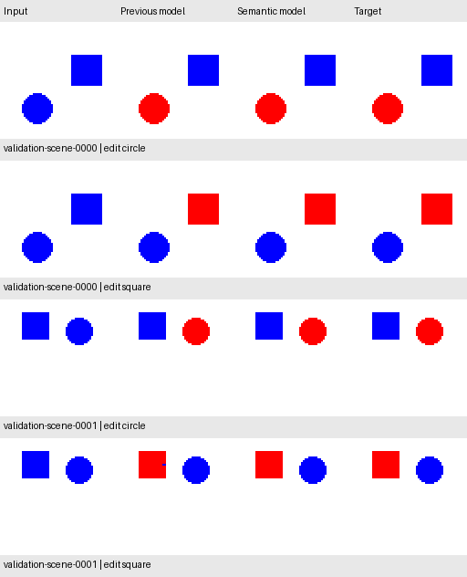
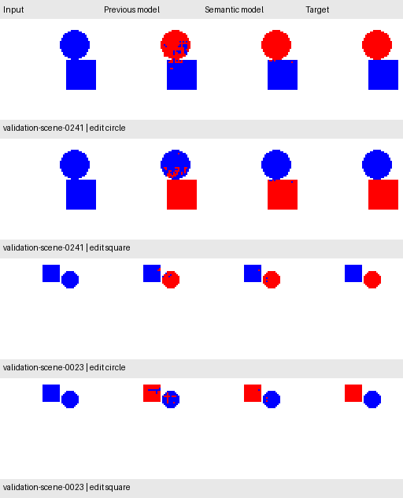

# Joint perception for more accurate, cheaper categorical editing

**Current status:** the [subsequent frozen test](instruction_test_evaluation.md)
gets 972/1,000 exact requests (97.2%) and 482/500 exact scene pairs (96.4%).
The reserved test is now observed. The validation-development account below
retains its original sequence and pre-test decisions.

## Protocol declared before the full experiments

The previous binary editor still damages circles during square requests. This
experiment changes the decomposition: learn a shared **background / circle /
square** class map from RGB, then let the categorical instruction select the
predicted circle or square class. Three-class argmax gives mutually exclusive
regions without a mask-confidence search. A fixed renderer paints the selected
region red. This is a specialized perception model plus explicit task routing,
not a learned instruction embedding or language understanding.

Training labels are built from the paired masks already available in the
training split. Images enter the model; masks never enter its forward method.
Each of the 2,500 training scenes is processed once per epoch, instead of twice
under different requests. Validation retains the same 250 scenes / 500 requests.
No new data, pretrained weights, augmentation, or test images are used.

### Three fixed comparisons

| Config | Architecture | Objective |
| --- | --- | --- |
| `semantic_dilated_v1` | Four 16-channel dilated convolutions, 3-class head; 7,459 parameters | Class-balanced cross entropy |
| `semantic_lite_ce_v1` | Small encoder/decoder with skip connections and separable residual blocks; 5,963 parameters | Same cross entropy |
| `semantic_lite_dice_v1` | Identical small model and initial weights to the previous row | Same cross entropy + 0.5 foreground soft Dice loss |

The small encoder/decoder uses widths 8, 12, 16 at full, half, and quarter
resolution. Two skip connections restore fine detail after bilinear upsampling
(`align_corners=False`). Each residual block uses two depthwise 3x3 plus
pointwise 1x1 convolutions. No normalization, dropout, or stochastic augmentation
is used. The original models/checkpoints are retained unchanged.

All three use seed **42**, **40 epochs**, batch size **64**, and Adam at **0.001**.
Each selects its own checkpoint by the lowest validation training-objective
loss, ties keeping the earliest epoch. Class weights are
`training_pixels / (3 * training_class_pixels)` and are fixed from training only.
Weighted cross entropy uses a pixel mean. Optional Dice averages the two
foreground classes for each image, with linear denominator and smoothing 1.

Rank the three selected checkpoints by exact validation scene pairs, then exact
requests, then fewer wrong pixels, then fewer convolution MACs, then config name.
Repeat the selected recipe from scratch with **seeds 7 and 2026**, keeping all
other settings fixed. Keep every result and do not choose a new recipe based on
the repeat outcomes. This tests limited seed sensitivity on the same validation
split; it does not create a new independent holdout.

The historical reference is the saved 24-epoch instruction model with the
validation-selected **0.95 cutoff**: 311/500 requests and 103/250 scene pairs.
Its checkpoint, config, manifest, and evaluated file hashes are checked. It is
a practical before/after comparison. The new three-class supervision, loss,
number of unique scene passes, and epoch budget differ, so the historical
comparison cannot isolate the effect of architecture. The two small-model
runs isolate the added Dice term under otherwise matched settings.

### Efficiency and correctness checks

Final scoring runs on CPU after loading selected weights. Report exact requests
and scene pairs, each task separately, all error-region counts, improvements and
regressions, and first-four and explicitly worst-four validation previews.

Measure parameter counts, serialized checkpoint sizes, and convolution MACs
for one request and both requests on the same scene. MACs exclude bias,
activations, interpolation, and other non-convolution operators; one MAC is not
one FLOP. Measure CPU model-plus-decoding latency with four threads, 10 warmups
and 100 samples per operation. Alternate timing order and report median/p90.
The reference batches both requests; the semantic model reuses one scene pass.
File loading, normalization, and RGB rendering are excluded from timings.
These are local measurements rather than general deployment speed guarantees.

All commands use the normal config runner:

```bash
uv run --locked python scripts/run_experiment.py --config configs/semantic_dilated_v1.json
uv run --locked python scripts/run_experiment.py --config configs/semantic_lite_ce_v1.json
uv run --locked python scripts/run_experiment.py --config configs/semantic_lite_dice_v1.json
```

The reserved instruction test set remains unopened for model performance.
Validation has already been used repeatedly for development; improvements need
a later frozen evaluation before claims about new-scene generalization.

## Design references

- [U-Net](https://arxiv.org/abs/1505.04597): contracting/expanding paths and
  fine-resolution skip connections for localization. This is a much smaller
  adapted architecture, not a reproduction of that paper.
- [MobileNets](https://arxiv.org/abs/1704.04861): depthwise separable convolutions
  as a compute-saving building block. Lower MACs do not automatically mean
  lower latency on every backend.
- [V-Net](https://arxiv.org/abs/1606.04797): overlap-based training for imbalanced
  segmentation. Our optional linear-denominator foreground Dice variant is
  specified above and is not the exact original V-Net objective.
- Implementation uses the installed PyTorch 2.15.0 reference docstrings for
  `Conv2d(groups=...)`, `cross_entropy`, `interpolate`, and `one_hot`. No new
  dependency is introduced.

## Initial three-model result and replication selection

All three seed-42 runs used clean revision
[`6ccf34e`](https://github.com/VishwasSP01/visual-learning-lab/commit/6ccf34edeabdf0ea9b96a116e04ab3037fd0abcc).
They evaluated the same validation inputs and labels; each reproduces the
reference's 311 exact requests and 103 exact scene pairs at its saved cutoff.

| Model | Selected epoch | Exact requests / 500 | Exact scene pairs / 250 | Wrong pixels |
| --- | ---: | ---: | ---: | ---: |
| Historical binary reference, cutoff 0.95 | 24 | 311 (62.2%) | 103 (41.2%) | 1,216 |
| **Joint dilated, balanced CE** | **39** | **472 (94.4%)** | **230 (92.0%)** | **104** |
| Small encoder/decoder, balanced CE | 40 | 395 (79.0%) | 154 (61.6%) | 285 |
| Same small model, CE + 0.5 Dice | 40 | 420 (84.0%) | 180 (72.0%) | 338 |

Dice improves exact outputs for the small model but increases total wrong pixels.
The small-model initial state hashes match, verifying equal initialization.
The declared ranking selects **the joint dilated model**. Its recipe is now
repeated with seeds 7 and 2026 in committed configs, without changing settings.

The depthwise encoder/decoder uses only 6.77 million convolution MACs per scene,
versus 30.28 million for the joint dilated model. Nevertheless, measured CPU
single-request medians are roughly 3.9 ms versus 0.58 ms. Operator overhead and
backend behavior matter; fewer MACs are insufficient evidence of lower latency.
The dilated model's initial timing is slightly slower for one request than the
reference (0.58 vs 0.53 ms), but faster for both requests on one scene
(0.58 vs 0.94 ms). These are local measurements with the protocol above.

Reports: [joint dilated](experiments/semantic_dilated_v1_validation.json),
[small CE](experiments/semantic_lite_ce_v1_validation.json),
[small CE + Dice](experiments/semantic_lite_dice_v1_validation.json).

## Seed sensitivity and a declared longer budget

The two repeat runs from clean revision
[`7648508`](https://github.com/VishwasSP01/visual-learning-lab/commit/764850894b0e57159f7a875c06cce098738d8470)
expose substantial instability at 40 epochs:

| Seed | Selected epoch | Exact requests / 500 | Exact pairs / 250 | Wrong pixels |
| --- | ---: | ---: | ---: | ---: |
| 42 | 39 | 472 (94.4%) | 230 (92.0%) | 104 |
| 7 | 40 | 428 (85.6%) | 201 (80.4%) | 310 |
| 2026 | 38 | 328 (65.6%) | 101 (40.4%) | 488 |

Seed 2026 even slightly trails the historical reference on paired-scene success
(101 vs 103). Lower validation loss alone does not guarantee more exact edits.
The seed-42 headline therefore does not establish a stable improvement.
All results are retained: [seed 7](experiments/semantic_dilated_v1_seed_7_validation.json)
and [seed 2026](experiments/semantic_dilated_v1_seed_2026_validation.json).

Training losses are still falling at epoch 40 for all three seeds; the selected
epochs are close to the budget limit. Before running another comparison, the
`semantic_dilated_v2` configs extend **all three seeds to 100 epochs from
scratch**, keeping architecture, loss, optimizer, learning rate, batch size,
dataset, decoder, and checkpoint-selection rule unchanged. We do not switch
recipes based on the repeats or discard the weak seed. This is a validation-led
budget change with preserved earlier results; the test remains reserved.

## Recorded 100-epoch results

All three longer runs started from clean revision
[`7664c7c`](https://github.com/VishwasSP01/visual-learning-lab/commit/7664c7cebe74ea86090b93894f1ec081ad736635).

| Seed | Selected epoch | Exact requests / 500 | Exact pairs / 250 | Wrong pixels |
| --- | ---: | ---: | ---: | ---: |
| **42** | **100** | **491 (98.2%)** | **244 (97.6%)** | **20** |
| 7 | 99 | 474 (94.8%) | 231 (92.4%) | 86 |
| 2026 | 99 | 478 (95.6%) | 234 (93.6%) | 36 |

The arithmetic mean across these three training seeds is 96.2% exact requests
and about 94.5% exact scene pairs. All use the same validation scenes, so this
is seed sensitivity rather than three independent data evaluations. MPS
numerics can vary across environments. The weak 40-epoch run remains published.

Keep seed 42 as the primary recorded model, continuing the original discovery
seed rather than selecting a new seed from the repeats. It has 245/250 exact
circle requests and 246/250 exact square requests. Relative to the historical
reference, 180 requests and 141 scene pairs become exact, with no regressions
on this validation set. Its remaining 20 wrong pixels comprise 9 missed intended
edits, 8 unwanted opposite-object edits, and 3 unwanted white-background edits.
The other seeds do have regressions against the reference: seed 7 loses 4 exact
requests and 2 exact pairs; seed 2026 loses 2 requests and 1 pair.

The model has 7,459 parameters versus 8,009 for the binary reference (6.9% fewer).
Convolution MACs fall from 32.51M to 30.28M for one request, and from 65.01M to
30.28M for both requests on one scene (53.4% fewer). Its saved checkpoint is
33,445 bytes; checkpoints are excluded from Git. These inference savings come
with a larger training budget than the original reference; we do not claim
lower training cost or an architecture-only causal improvement.

Reports: [seed 42](experiments/semantic_dilated_v2_validation.json),
[seed 7](experiments/semantic_dilated_v2_seed_7_validation.json),
[seed 2026](experiments/semantic_dilated_v2_seed_2026_validation.json), and the
[seed-42 selected configuration](experiments/semantic_dilated_v2_selected_config.json).
An independent NumPy evaluation reloaded all **eight** saved semantic checkpoints
(the initial three, two short repeats, and three longer runs) with inference
batch size 37. It reproduced every aggregate and per-task raw metric count and
exact-scene count, including the reference, using no project loader, renderer,
or metric implementation. Only validation image files were read.

The first two validation scenes under both requests, kept in manifest order:



The four worst requests under the seed-42 semantic model, sorted by wrong-pixel
count and then request ID, show the remaining close-object and edge errors:



## Equivalent decoder optimization protocol

The initial benchmark uses a full 3-class `argmax` followed by object selection.
For two known objects we can compare channels directly: circle wins when its
score exceeds background and is at least square; square wins when its score
exceeds both. This preserves the lowest-class-index tie rule of `argmax` for
finite logits. The helper returns both object masks without an intermediate
integer class map. It uses no labels, geometry, or shape heuristics.

Before timing, verify that both decoders produce identical masks on all 250
validation scenes / 500 requests at the saved seed-42 weights. Unit tests cover
every three-way tie pattern using scores -1, 0, and 1, plus random scores.
Then compare both decoders with the historical reference using the same CPU
timing protocol above, without changing weights, class decisions, or accuracy
settings. The finite-output check is performed before timing; the timed fast
path assumes finite logits.

```bash
uv run --locked python scripts/run_experiment.py --config configs/semantic_dilated_v2_decoder.json
```

### Recorded decoder and latency result

The comparison ran from clean revision
[`72d9ed2`](https://github.com/VishwasSP01/visual-learning-lab/commit/72d9ed2c87f1192aae3ec89b17867cabc8059a74).
The direct-comparison decoder matches **all 500 request masks** exactly.
It does **not materially improve latency** over argmax in this measured setup:
single-request medians are 0.592 ms for each decoder. Lower intermediate storage
does not imply a faster end-to-end operation here. Both routes remain available;
the recorded training/evaluation path retains ordinary argmax.

| CPU operation, comparison decoder | Historical reference median / p90 | New model median / p90 |
| --- | ---: | ---: |
| One request | 0.514 / 0.549 ms | 0.592 / 0.620 ms |
| Both requests on one scene | 0.939 / 1.013 ms | 0.597 / 0.618 ms |

The new model is about **1.57x faster for both requests on one scene** in this
local benchmark, because it reuses perception. It is about **15% slower for a
single request**. This is an explicit accuracy/latency tradeoff, not a claim of
universal speed improvement. Measurements exclude image loading, normalization,
and RGB rendering, and are subject to local CPU scheduling and backend effects.
See the [full decoder report](experiments/semantic_dilated_v2_decoder.json).

## Current scope and next decision

This milestone improves exact editing substantially on the repeatedly used
synthetic validation split, retains weaker candidates and seeds, and measures
where shared inference saves work. It does not establish real-image quality or
general language understanding. The default demo now uses this model; the
original circle-only editor remains available through `--mode spatial`.
Reproduction commands above train local checkpoints;
weights and generated datasets stay outside Git.

The model and evaluation protocol were subsequently frozen and tested; see the
[frozen test report](instruction_test_evaluation.md). Further model tuning
requires fresh held-out evidence; the already observed instruction test cannot
become an unseen test again.
