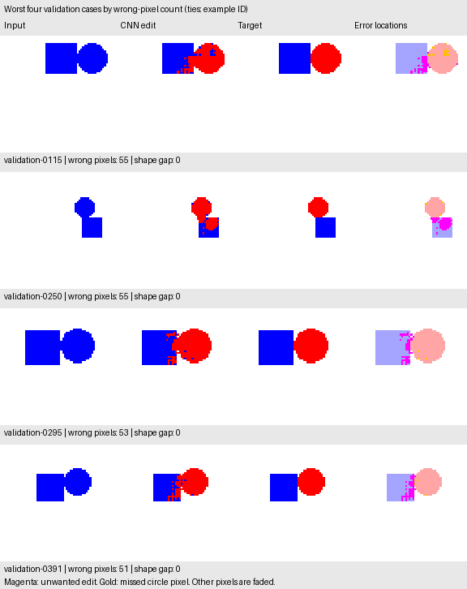

# Inspecting the CNN's mistakes

We inspected the saved first CNN on the same 500 validation images. There was
no retraining, threshold adjustment, or use of the held-out test dataset.
Reloading the checkpoint on CPU reproduced the original aggregate error counts.

## What went wrong?

The network produced 210 completely correct images and 290 with at least one
incorrect pixel. Across 2,048,000 pixels, there were 1,639 errors:

| Error type | Wrong pixels |
| --- | ---: |
| Square pixels incorrectly recolored | 1,091 |
| White background pixels incorrectly recolored | 421 |
| Circle pixels that should have been recolored but were missed | 127 |
| Total | 1,639 |

Most errors are extra edits rather than missed circle pixels. This explains
why excellent pixel accuracy can coexist with a modest exact-image score.

## Shapes close together are harder in this validation sample

We measured the minimum distance between the two foreground masks using an
eight-neighbor (Chebyshev) grid, minus one. Adjacent foreground pixels have a
gap of zero. The groups below were defined before running the analysis.

| Empty-pixel gap | Images | Images with errors | Wrong pixels | Mean wrong pixels per image |
| --- | ---: | ---: | ---: | ---: |
| 0-1 | 35 | 34 | 823 | 23.51 |
| 2-5 | 66 | 59 | 432 | 6.55 |
| 6 or more | 399 | 197 | 384 | 0.96 |

The closest group contains only 7% of validation images but about 50.2% of all
wrong pixels. This is an association in one validation sample, not proof that
distance alone causes the errors. Size and image-edge position also vary.
The report includes separate summaries of those factors, without claiming they
are independent causal effects.

## Are all mistakes near a shape boundary?

No. A two-pixel square-neighborhood boundary band contains 1,250 errors;
389 errors lie farther from either shape boundary. Boundary refinements alone
are therefore not established as a complete solution.

## Visual examples

The four examples below are the worst by wrong-pixel count, with ties broken
by example ID. This selection is for diagnosis, not a representative average.
Magenta marks unwanted edits; gold marks missed circle pixels. Correct regions
are faded so small mistakes remain visible.



The [recorded analysis](experiments/shape_cnn_v1_errors.json) contains totals,
group denominators, source/checkpoint fingerprints, and the selected example IDs.
The reproducible script also saves all 500 per-example records locally.

## Reproduce

After generating the dataset and training the first CNN:

```bash
uv run --locked python -m unittest discover -v
uv run --locked python analyze_spatial_errors.py
open results/spatial_cnn/error_analysis/worst_cases.png
```

The analyzer rejects a mismatched manifest or a checkpoint that does not
reproduce its reference validation counts. Generated outputs live under
`results/spatial_cnn/error_analysis/`; the small recorded report and preview
above are versioned separately.

## The subsequent controlled experiment

The original decision was to edit whenever the sigmoid score was at least
0.5. Since unwanted edits dominated these observed errors, the subsequent
[threshold experiment](confidence_thresholds.md) compared a small, declared set
of higher thresholds while holding model weights and data fixed. It measured
both unwanted edits and missed circle pixels; requiring a larger score can
reduce one error while increasing the other. Threshold selection belongs on
validation data, with the test split reserved for a later frozen configuration.
